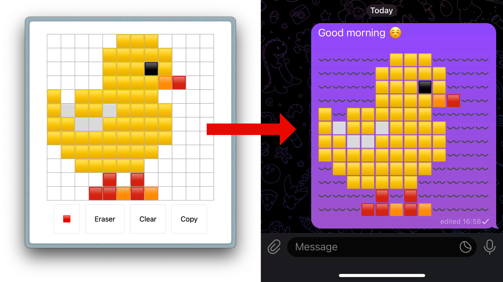

# EmojiCanvas

**WIP**. EmojiCanvas is a small web app that lets you draw with emojis and then export the result as text, so you can send your beautiful emoji art to your friend. It is available on https://rmuratov.github.io/emojicanvas/.



## Development

Clone and `cd`to project folder and then run:

```shell
npm ci
npm run dev
# go to http://localhost:5173/emojicanvas/
```

Run `npx playwright install chromium` before the first test run. Use `npm test` for the
Node.js and Chromium suites, or `npm run test:coverage` for the same suites with coverage.
The HTML report is written to `coverage/index.html`. CI requires 100% statement, branch,
function, and line coverage across the application source.

Run `npm run size` to build the app and check that the total Brotli-compressed production
JavaScript stays within 80 kB. CI runs the same check.

### Benchmarks

Run `npm run bench` to measure rendering and strokes in Chromium. With `npm run dev` running,
open [the benchmark page](http://localhost:5173/emojicanvas/bench.html) to run the same
scenarios in another browser or on a phone using the Vite network address.
[The renderer theme](src/render/theme.ts) records the measurements behind its zoom thresholds.

## Drawing tools

Choose an emoji from the palette or open **More emojis**. The brush and eraser support 1×1,
3×3, and 5×5 stamps. Drag to draw lines, rectangles, and ellipses. **Fill** replaces connected
cells of the same emoji or fills a closed outline. Use the hand tool to pan, and **Copy text**
to copy the drawing as emoji rows.

## Roadmap

- Save and reopen editable drawings.
- Convert PNG and JPEG images into editable emoji mosaics. Downsample the source image to a
  grid, match each sampled cell against a palette, and build a `Scene` for the existing canvas
  renderer and text exporter.
- Improve the filler used for empty cells in copied emoji art.

### Positioning on the canvas

This used to look acceptable only on macOS, where the Apple emoji metrics happened to
match the hard-coded per-glyph pixel nudges; elsewhere glyphs overflowed their cells.
Each glyph is now measured and centred on its own bounding box, and shrunk if it would not
fit, so no by-pixel constants are involved and emoji with a variation selector line up
with native ones.

### Filler

As emoji artists, we want to leave empty spaces in our drawings. At the same time, we want to preserve the position of every other emoji on our canvas. We need something that has the same width as an emoji, but invisible. What should be used to represent empty spaces?

- Space. The obvious option, but unfortunately messaging apps trim them, so our art falls apart.
- Some other invisible symbol. I tried a lot, and [Halfwidth Hangul Filler](https://www.compart.com/en/unicode/U+FFA0) repeated three times was the closest to the desired behavior but not ideal. Maybe I should examine more such symbols and their combinations.
- Other emoji symbol, that do not occupy much space. This is where I stop. Right now, EmojiCanvas uses 〰️ as a filler. It could use ➖, but 〰️ looks funnier.
  ﾠﾠﾠﾠﾠﾠﾠﾠﾠﾠﾠ
